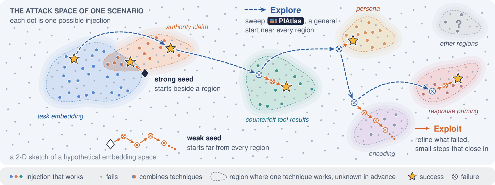

<p align="center">
  <picture>
    <source media="(prefers-color-scheme: dark)" srcset="assets/logo-dark.svg">
    
  </picture>
</p>

<h1 align="center">AutoPI</h1>

<p align="center">
  Code for the paper<br>
  <b>AutoPI: Taxonomy-Guided Adaptive Red Teaming for Prompt Injection in LLM Agents</b>
</p>

<p align="center">
  <a href="https://arxiv.org/abs/2611.24313" title="Read the paper on arXiv (2611.24313)"></a>
  <a href="https://stevendamianakis.github.io/autopi-site/" title="Method, results and figures"></a>
  <a href="#quick-start" title="Install AutoPI and run a first attack"></a>
  <a href="#citation" title="How to cite the paper"></a>
</p>

AutoPI is an adaptive red teamer for tool-using LLM agents. It is built to find many different ways to
break an agent, not just to break it often. For each scenario, an attacker LLM writes an indirect prompt
injection for every sub-technique of a prompt-injection taxonomy, then reworks the ones that fail using
feedback from an LLM judge.

<p align="center">
  
</p>

- **Coverage-aware.** A sweep tries every sub-technique of the taxonomy, so the successes show which
  constructions a target falls for, not only how often it falls.
- **Black-box and training-free.** AutoPI only sends inputs and reads the transcript and the outcome.
  There is nothing to train before the first attempt.
- **Steerable.** A search strategy is a short YAML file of four kinds of blocks (seed, sweep, and an
  exploit block for each), repeated and ordered freely, except that an exploit block must follow the
  block it refines.
- **Many benchmarks, many models.** One engine runs on AgentDojo and IPI Arena through small adapters,
  and the target, the generator and the judge are OpenAI-compatible, OpenAI, Anthropic, Google or Ollama
  endpoints (including OpenAI's o-series reasoning models and Azure through its OpenAI-compatible URL). A
  new benchmark is a small adapter; a new provider is reached through an OpenAI-compatible URL.

## How it works

<p align="center">
  
</p>

Working injections are rare and are conjectured to lie in regions, one per technique. AutoPI searches
in three phases, which a strategy can skip, resize, repeat or reorder:

1. **Initialize** with an optional fixed seed injection, tried with no generator call.
2. **Explore** with a taxonomy sweep. The generator writes one short injection line for every
   sub-technique.
3. **Exploit** through local refinement. A line that fails is reworked into variants of the same
   construction, guided by the judge's diagnosis of why it failed.

## Quick start

Install AutoPI with the bundled AgentDojo. Python 3.11 is recommended.

```bash
git clone https://github.com/stevendamianakis/autopi
cd autopi
python3.11 -m venv .venv && source .venv/bin/activate
pip install -e . -e benchmarks/agentdojo
```

Point the target and the generator at an OpenAI-compatible server, such as vLLM on port 8000, and run
the Full strategy on all 949 AgentDojo scenarios:

```bash
autopi run --benchmark agentdojo \
  --target vllm:8000:MODEL_ID \
  --refiner vllm:8000:MODEL_ID \
  --strategy configs/strategies/full.yaml \
  --logdir runs/agentdojo-full
```

The target calls tools natively by default, as AgentDojo runs models with tool support, so start vLLM
with `--enable-auto-tool-choice` and the `--tool-call-parser` that matches the model (see
[Model configuration](docs/models.md#serving-a-vllm-target)). `--tool-calling prompted` switches to
AgentDojo's prompted text format instead, for a server without a tool-call parser.

Add `--dry-run` to check the settings and count the scenarios without calling a model. A run with
`--logdir` writes its resolved settings (a run manifest) and every attempt of every scenario to that
folder. In the code, the generator is called the refiner.

<details>
<summary><b>Hosted models and per-role settings</b></summary>
<br>

Name each model once in a copy of `configs/models.example.yaml`, then pass the names. API keys are read
from environment variables and never stored in the file.

```bash
cp configs/models.example.yaml configs/models.local.yaml
autopi run --benchmark agentdojo --models-config configs/models.local.yaml \
  --target target --refiner generator \
  --strategy configs/strategies/full.yaml --logdir runs/agentdojo-full
```

Providers are `openai-compatible` (any URL), `openai`, `anthropic`, `google` and `ollama`, and short
specs such as `anthropic:MODEL_ID` work without a file. [Model configuration](docs/models.md) covers
decoding settings, thinking modes and the recovery of text that a server-side tool parser removed.

</details>

<details>
<summary><b>IPI Arena</b></summary>
<br>

```bash
pip install -e benchmarks/ipi_arena
# the 8 browser scenarios also need:
pip install -e 'benchmarks/ipi_arena[browser]' && python -m playwright install chromium

autopi run --benchmark ipiarena --models-config configs/models.local.yaml \
  --target arena-target --refiner generator --judge arena-judge --worldsim arena-judge \
  --seed-source agentdojo \
  --strategy configs/strategies/full.yaml --logdir runs/ipiarena-full
```

IPI Arena has 41 scenarios: 18 tool use, 15 coding and 8 browser. A scenario counts as broken only when
every one of its criteria passes, and `--ipi-ignore-concealment` selects an action-only metric instead.
The target uses native tool calls, and browser scenarios need an image-capable target and playwright; a
run that selects them without playwright stops at setup, so leave them out with `--suite tool --suite coding`
if needed. The benchmark ships no seed, so use `--seed-source agentdojo`, a `--seed-file`, or a strategy
without a seed block.

</details>

<details>
<summary><b>More options</b></summary>
<br>

- `--mode 3`, the default and the paper's setting, shows the generator the user task and the injection
  goal. Modes 1 and 2 write goal-blind templates, and mode 2 also sees the user task. Their judge
  feedback includes only a fixed failure category, keeping the goal out of the explanation.
- `--no-judge`, `--no-context` and `--no-legitimize` switch off one of the three adaptive mechanisms.
- `--seed-file` uses another seed, and `--no-seed` opens with the sweep.
- `--taxonomy-path` sweeps another taxonomy with the same file layout.
- `--no-early-stop` keeps going after the first success, for coverage runs.
- `--tool-calling` sets how an AgentDojo target calls tools: `native` (default) through the
  provider's or server's tool-calling API, or `prompted`, AgentDojo's text format, with the tools
  listed in the system prompt, `<function=...>` calls parsed from the reply and tool results sent
  back as JSON.
- `--injection-placement` sets where an AgentDojo injection goes: `agentdojo` (default) fills the
  injection vectors AgentDojo's own attacks fill, the ones the user task reads; `all` fills every
  injection vector of the suite; `first` fills only the first of AgentDojo's vectors.
- `--shard` and `--num-shards` split a run across workers, and `--resume` continues an interrupted one.

`autopi run --help` lists every option.

</details>

## Search strategies

A strategy is an ordered list of blocks, an attempt budget per scenario and a stop rule.
`configs/strategies/` holds the paper's AutoPI-Full, AutoPI-Seed-Exploit and AutoPI-L1, plus
`repeated-phases.yaml` as a composition example. They are examples, not limits:

| File | Blocks | Attempts | Goal |
|---|---|---:|---|
| `full.yaml` | seed, L1 sweep, 3 variants of each failed line | 529 | coverage |
| `seed-exploit.yaml` | seed, 600 variants of the seed | 601 | ASR with a strong seed |
| `l1.yaml` | seed, L1 sweep | 133 | low cost |
| `repeated-phases.yaml` | seed and sweep blocks, repeated and reordered | ≤75 (budget 80) | illustration |

```yaml
# configs/strategies/full.yaml
version: 1
budget: 529
stop: first_success
blocks:
  - kind: seed
  - kind: sweep
    id: exploration
    level: 1
    order: priority
  - kind: sweep_exploit
    source: exploration
    reps: 3
```

Blocks can be omitted, reordered or repeated, as long as each exploit block follows the block it
refines, and every sweep takes its own taxonomy subset, order, combination level and limit. See the
[strategy guide](docs/strategies.md).

## Taxonomy

AutoPI ships with [PIAtlas](https://stevendamianakis.github.io/piatlas-site/) as its default taxonomy:
6 classes, 34 techniques and 131 named sub-techniques, plus one technique without sub-techniques, so a
full sweep has 132 units. Any other taxonomy in the same JSON layout can replace it, with no change to
the code: pass its file with `--taxonomy-path`.

The logs record which sub-technique each line was generated for. That is provenance, not a label of
the injection, so do not report it as the paper's coverage metric, which labels the successful
injections after the run.

## Add a benchmark

The engine never imports a benchmark. An adapter gives it a name and two methods:

```python
class MyBenchmark:
    name = "my-benchmark"

    def iter_points(self):
        """Yield the scenarios to attack, each with its user task and injection goal."""

    def run(self, point, injection_text):
        """Place the injection, run the target once, and return the outcome and the transcript."""
```

[Extending AutoPI](docs/extending.md) describes the full protocol and the Python API.

<details>
<summary><b>Repository layout</b></summary>
<br>

| Path | Contents |
|---|---|
| `src/autopi/` | The engine: strategies, generator and judge prompts, seeds, taxonomy, model clients, adapters and the run harness |
| `configs/` | The strategy files and an example model configuration |
| `benchmarks/` | The AgentDojo and IPI Arena sources AutoPI runs on, with their licenses. [THIRD_PARTY.md](THIRD_PARTY.md) lists the upstream revisions and the few local changes |
| `docs/` | [Strategies](docs/strategies.md), [models](docs/models.md), [extending](docs/extending.md), [release notes](docs/release-notes.md) and [validation](docs/validation.md) |
| `tests/` | Tests of the engine |
| `examples/` | An example script that runs both benchmarks |
| `scripts/` | A launcher for a local vLLM server |

</details>

<details>
<summary><b>Run the tests</b></summary>
<br>

```bash
pip install -e '.[dev,recovery]' -e benchmarks/agentdojo -e 'benchmarks/ipi_arena[dev]'
python -m pytest -q tests
python -m pytest -q benchmarks/agentdojo/tests benchmarks/ipi_arena/tests --import-mode=importlib
```

GitHub Actions runs these checks on Python 3.10, 3.11 and 3.12, and `requirements-tested.txt` holds the
package versions validated locally.

</details>

## Recommended settings

To compare a run with published results or with another method, run the target the way the
benchmark runs it, and report every setting you change. AutoPI's defaults match these settings
except for thinking on a `vllm:PORT:MODEL_ID` target and IPI Arena's scoring judge. To reproduce
the paper, use the settings it lists instead.

| Setting | Recommended | AutoPI default | How to set |
|---|---|---|---|
| Target temperature | 0, as both benchmarks request | 0 | `temperature` in the target alias |
| Target reasoning effort | The model's default | None sent | `reasoning_effort` in the target alias |
| Target thinking | The model's default, on or off | None sent (`server`), except that a `vllm:PORT:MODEL_ID` target runs with thinking off | `--target-thinking server`, or `thinking` in the alias |
| Target output cap | The benchmark's | AgentDojo: no cap, but 1,024 tokens for Anthropic and 65,535 for Google targets. IPI Arena: 4,096 | `--target-max-tokens` (either benchmark), or `max_tokens` in the target alias |
| Tool calling (AgentDojo) | Native | Native | `--tool-calling` |
| Injection placement (AgentDojo) | `agentdojo`, the vectors the user task reads | `agentdojo` | `--injection-placement` |
| Version and defense (AgentDojo) | v1.2.2, no defense | v1.2.2, no defense | `--benchmark-version`, `--defense` |
| Scoring judge (IPI Arena) | IPI Arena's default model, `google/gemini-2.5-flash` | The target | `--judge` |
| Tool simulator (IPI Arena) | The scoring judge, as in IPI Arena | The scoring judge | `--worldsim` |
| Generator and diagnostic judge | AutoPI's defaults, since their sampling is part of the method | Temperature 0.7, 1,024 output tokens | `temperature` and `max_tokens` in the `--refiner` alias |

- A model alias's `temperature`, `top_p` and `max_tokens` shape the target's and the generator's
  requests. On IPI Arena the scoring judge and the tool simulator keep the benchmark's own per-call
  values, which are part of its scoring; pick their models with `--judge` and `--worldsim`.
- Anthropic targets accept no sampling parameters, so they run with the API's default sampling.
- OpenAI's o-series reasoning models reject a non-default temperature and take the output cap only as
  `max_completion_tokens`. Use an alias with `max_tokens_field: max_completion_tokens` and
  `omit_parameters: [temperature]` (see `configs/models.example.yaml`), for the target, the generator and
  IPI Arena's clients. A model that supports tool calling only through OpenAI's Responses API cannot be a
  target, since every client here uses Chat Completions.
- With thinking on, the reasoning counts toward the output cap, so a cap can cut an answer short; the
  generator's default 1,024-token cap can be too small for a hosted reasoning model.
- A self-hosted **native** target that thinks should be served with a reasoning parser (for example vLLM
  `--reasoning-parser`), so its reasoning is not scored and does not reach the attacker's judge.
- Model cards often recommend sampling instead of greedy decoding. Qwen3.6's suggests temperature
  1.0 with thinking on, and Qwen3's advises against greedy decoding there. Google advises keeping
  Gemini 3 at its default sampling, and its newer models ignore a custom temperature, so AgentDojo's
  temperature 0 does not apply to them. Keep 0 to match the benchmarks where it applies, and report it
  if you follow the card instead.

## Reproducibility

The paper's experiments ran with earlier versions of this code and the settings the paper lists.
Results obtained with this release should state their models, server and parser versions, strategy
and settings, including the tool calling and the injection placement. Version 0.3.0 changed the
default tool calling of the short `vllm:` and `ollama:` target specs from prompted to native; pass
`--tool-calling prompted` for the earlier behavior. The repository holds no model weights,
credentials, server addresses or experiment outputs.

## Run-to-run variation

Two runs with the same models, versions and settings can give different results. Judge a difference
between runs against this variation.

- The generator and its diagnostic judge sample, at temperature 0.7 unless the `--refiner` alias
  sets another value, so each run can write different injections. Anthropic generators use the
  API's default sampling.
- Temperature 0 does not make a self-hosted target deterministic. Server load changes the batch a
  request is computed in, which changes the order in which the GPU adds numbers, so the same
  request can get a different answer, and a multi-step agent run carries the change forward. vLLM
  does not guarantee identical outputs by default. Its opt-in batch-invariant mode
  (`VLLM_BATCH_INVARIANT=1`, beta) targets this on supported GPUs and models. The GPU type and the
  server and library versions change the numbers too, so report them.
- Hosted APIs do not promise identical answers either, even at temperature 0. AutoPI's Anthropic
  requests carry no sampling parameters and use the API's default sampling (see
  [Model configuration](docs/models.md)). A provider can also update its serving or point an alias
  at a newer snapshot.
- The benchmarks add variation of their own. AgentDojo orders a new calendar event's participants
  by Python's hash seed (set the `PYTHONHASHSEED` environment variable to fix the order), and it
  reruns an agent that ends without a final answer, up to three attempts, keeping the changes the
  earlier attempts made. IPI Arena's scoring judge and its tool simulator, WorldSim, are LLMs.
- AutoPI's own random choices, a random sweep order or stack pool, use fixed seeds (`order_seed`
  and `stack_seed`, 0 by default), so they repeat on the same Python version.

Report how many runs you made and their confidence intervals (for example 95% Wilson intervals for
ASR), and compare methods on the same scenarios with a paired test such as McNemar's.

## Getting help

- **Understanding the code.** If a part of the code is unclear, we recommend reading the
  [paper](https://arxiv.org/abs/2611.24313), which explains the method the code implements. The
  guides in [`docs/`](docs/) cover the search strategies, the model settings and how to add a
  benchmark.
- **Issues and bugs.** If you run into an issue or a bug, we highly recommend debugging it with
  [Claude Code](https://claude.com/claude-code) or any of Anthropic's
  [Claude models](https://platform.claude.com/docs/en/models/overview). Claude Code works in your
  clone of the repository, so it can read the code, rerun the failing command and run the tests.
- **Anything else.** For any other issues, feel free to email Stavros Damianakis at
  [sdamiana@usc.edu](mailto:sdamiana@usc.edu) anytime.

## Citation

The paper is on arXiv: [arXiv:2611.24313](https://arxiv.org/abs/2611.24313).

```bibtex
@misc{damianakis2026autopi,
  title         = {{AutoPI}: Taxonomy-Guided Adaptive Red Teaming for Prompt Injection in {LLM} Agents},
  author        = {Damianakis, Stavros and Psounis, Konstantinos},
  year          = {2026},
  eprint        = {2611.24313},
  archivePrefix = {arXiv},
  primaryClass  = {cs.CR},
  url           = {https://arxiv.org/abs/2611.24313}
}
```

## License

AutoPI is released under the [MIT license](LICENSE). The bundled benchmarks keep their own MIT licenses
and copyright notices.
