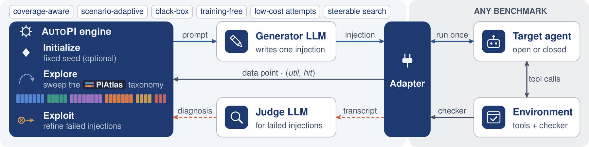

<p align="center">
  <picture>
    <source media="(prefers-color-scheme: dark)" srcset="assets/logo-dark.svg">
    
  </picture>
</p>

<h1 align="center">AutoPI</h1>

<p align="center">
  Code for the paper<br>
  <b>AutoPI: Taxonomy-Guided Adaptive Red Teaming for Prompt Injection in LLM Agents</b>
</p>

<p align="center">
  <a href="https://arxiv.org/abs/2611.24313" title="Read the paper on arXiv (2611.24313)"></a>
  <a href="https://stevendamianakis.github.io/autopi-site/" title="Method, results and figures"></a>
  <a href="#citation" title="How to cite the paper"></a>
</p>

AutoPI is an adaptive red teamer for tool-using LLM agents, built to find many different ways to break
an agent, not just to break it often. For each scenario, an attacker LLM (the generator) writes an
indirect prompt injection for every sub-technique of a prompt-injection taxonomy, then reworks the ones
that fail using feedback from an LLM judge.

<p align="center">
  
</p>

- **Coverage-aware.** Tries every sub-technique, so you see *which* attacks work, not only how often.
- **Black-box and training-free.** Needs only inputs and outcomes. There is nothing to train.
- **Steerable.** A search strategy is a short YAML file.
- **Any benchmark, any model.** Small adapters, and OpenAI-compatible, OpenAI, Anthropic, Google or Ollama endpoints.

## Quick start

Install AutoPI with the bundled AgentDojo. Python 3.11 is recommended.

```bash
git clone https://github.com/stevendamianakis/autopi
cd autopi
python3.11 -m venv .venv && source .venv/bin/activate
pip install -e . -e benchmarks/agentdojo
```

Run the Full strategy on all 949 AgentDojo scenarios, with the target and the generator on an
OpenAI-compatible server such as vLLM:

```bash
autopi run --benchmark agentdojo \
  --target vllm:8000:MODEL_ID \
  --generator vllm:8000:MODEL_ID \
  --strategy configs/strategies/full.yaml \
  --logdir runs/agentdojo-full
```

> [!TIP]
> Add `--dry-run` to check the settings and count the scenarios without calling a model.

- **Serving the target.** Start vLLM with `--enable-auto-tool-choice` and the model's `--tool-call-parser`, or pass `--tool-calling prompted` ([details](docs/models.md#serving-a-vllm-target)).
- **Results.** `--logdir` holds the run's settings and every attempt of every scenario.
- **Names.** A few code names differ from the paper's terms. The [glossary](docs/glossary.md) maps them.

### More setups

<details>
<summary><b>Hosted models and per-role settings</b></summary>
<br>

Name each model once in a copy of `configs/models.example.yaml`, then pass the names. API keys are read
from environment variables and never stored in the file.

```bash
cp configs/models.example.yaml configs/models.local.yaml
autopi run --benchmark agentdojo --models-config configs/models.local.yaml \
  --target target --generator generator \
  --strategy configs/strategies/full.yaml --logdir runs/agentdojo-full
```

Short specs such as `anthropic:MODEL_ID` work without a file. [Model configuration](docs/models.md)
covers providers, decoding settings and thinking modes.

</details>

<details>
<summary><b>IPI Arena</b></summary>
<br>

```bash
pip install -e benchmarks/ipi_arena
# the 8 browser scenarios also need:
pip install -e 'benchmarks/ipi_arena[browser]' && python -m playwright install chromium

autopi run --benchmark ipiarena --models-config configs/models.local.yaml \
  --target arena-target --generator generator --ipi-judge arena-judge --ipi-worldsim arena-judge \
  --seed-source agentdojo \
  --strategy configs/strategies/full.yaml --logdir runs/ipiarena-full
```

IPI Arena has 41 scenarios: 18 tool use, 15 coding and 8 browser. A scenario counts as broken only when
every one of its criteria passes (`--ipi-ignore-concealment` scores the action alone). The benchmark
ships no seed, so use `--seed-source agentdojo`, a `--seed-file`, or a strategy without a seed block.
Browser scenarios need an image-capable target, playwright and its Chromium; without them, leave the
browser scenarios out with `--suite tool --suite coding`.

</details>

<details>
<summary><b>More options</b></summary>
<br>

- `--mode 3`, the default and the paper's setting, shows the generator the user task and the injection goal.
- `--no-judge`, `--no-context` and `--no-legitimize` switch off one of the three adaptive mechanisms.
- `--seed-file` uses another seed, and `--no-seed` opens with the sweep.
- `--no-early-stop` keeps going after the first success, for coverage runs.
- `--tool-calling` and `--injection-placement` set how an AgentDojo target calls tools and where the injection goes.
- `--shard` and `--num-shards` split a run across workers, and `--resume` continues an interrupted one.

`autopi run --help` lists every option.

</details>

## How it works

<p align="center">
  
</p>

Working injections are rare and are conjectured to lie in regions, one per technique. AutoPI searches
in three phases, which a strategy can skip, resize, repeat or reorder:

1. **Initialize** with an optional fixed seed injection, tried with no generator call.
2. **Explore** with a taxonomy sweep. The generator writes one short injection line for every sub-technique.
3. **Exploit** through local refinement. A failed line is reworked into variants, guided by the judge's diagnosis.

## Search strategies

A strategy is a list of blocks, an attempt budget per scenario and a stop rule. The paper's three
strategies ship in [`configs/strategies/`](configs/strategies):

| Strategy | What it runs | Attempts | Best for |
|---|---|---:|---|
| [AutoPI-Full](configs/strategies/full.yaml) | seed, L1 sweep, 3 variants of each failed line | 529 | coverage |
| [AutoPI-Seed-Exploit](configs/strategies/seed-exploit.yaml) | seed, 600 rewrites of the seed | 601 | ASR from a strong seed |
| [AutoPI-L1](configs/strategies/l1.yaml) | seed, L1 sweep | 133 | low cost |

<details>
<summary><b>Show <code>full.yaml</code></b></summary>
<br>

```yaml
version: 1
budget: 529
stop: first_success
blocks:
  - kind: seed
  - kind: sweep
    id: exploration
    level: 1
    order: priority
  - kind: sweep_exploit
    source: exploration
    reps: 3
```

</details>

Blocks can be omitted, reordered or repeated, as long as each exploit block follows the block it
refines ([`repeated-phases.yaml`](configs/strategies/repeated-phases.yaml) is an example).

An **Ln sweep** writes one line for each set of n sub-techniques (`level` in the YAML), following the
intuition that working injections are often compositions of several techniques. The PIAtlas paper
([arXiv:2610.24999](https://arxiv.org/abs/2610.24999)) finds that attacks usually combine several
techniques, with the median curated injection template spanning two classes and three techniques. The
paper's strategies use L1 only. More in the [strategy guide](docs/strategies.md).

## Taxonomy

AutoPI ships with [PIAtlas](https://stevendamianakis.github.io/piatlas-site/) as its default taxonomy:
6 classes, 34 techniques and 131 sub-techniques, plus one technique without sub-techniques, so a full
sweep has 132 units. Any taxonomy in the same JSON layout can replace it through `--taxonomy-path`.

## Add a benchmark

The engine never imports a benchmark. An adapter gives it a name and two methods:

```python
class MyBenchmark:
    name = "my-benchmark"

    def iter_points(self):
        """Yield the scenarios to attack, each with its user task and injection goal."""

    def run(self, point, injection_text):
        """Place the injection, run the target once, and return the outcome and the transcript."""
```

[Extending AutoPI](docs/extending.md) describes the full protocol and the Python API.

<details>
<summary><b>Repository layout</b></summary>
<br>

| Path | Contents |
|---|---|
| `src/autopi/` | The engine, its prompts, model clients, adapters and run harness |
| `configs/` | The strategy files and an example model configuration |
| `benchmarks/` | AgentDojo and IPI Arena at their latest upstream versions ([THIRD_PARTY.md](THIRD_PARTY.md)) |
| `docs/` | Guides, release notes, validation and a glossary |
| `tests/` | Tests of the engine |
| `examples/`, `scripts/` | A script that runs both benchmarks, and a launcher for a local vLLM server |

</details>

<details>
<summary><b>Run the tests</b></summary>
<br>

```bash
pip install -e '.[dev,recovery]' -e benchmarks/agentdojo -e 'benchmarks/ipi_arena[dev]'
python -m pytest -q tests
python -m pytest -q benchmarks/agentdojo/tests benchmarks/ipi_arena/tests --import-mode=importlib
```

CI runs them on Python 3.10, 3.11 and 3.12, and `requirements-tested.txt` holds the package versions
validated locally.

</details>

## Comparing results

> [!NOTE]
> The paper's experiments ran with earlier versions of this code. To reproduce them, use the settings the paper lists.

To compare a run with published results or with another method, run the target the way the benchmark
runs it and report every setting you change. [Comparing results](docs/reproducing.md) lists the settings
to match, what to report, and why two runs of the same setup can differ.

## Getting help

- **Understanding the code.** The [paper](https://arxiv.org/abs/2611.24313) explains the method, and [`docs/`](docs/) covers strategies, models and new benchmarks.
- **Issues and bugs.** We highly recommend debugging with [Claude Code](https://claude.com/claude-code) or any of Anthropic's [Claude models](https://platform.claude.com/docs/en/models/overview). Claude Code can read the code, rerun the failing command and run the tests.
- **Anything else.** Feel free to email Stavros Damianakis at [sdamiana@usc.edu](mailto:sdamiana@usc.edu) anytime.

## Citation

The paper is on arXiv: [arXiv:2611.24313](https://arxiv.org/abs/2611.24313).

```bibtex
@misc{damianakis2026autopi,
  title         = {{AutoPI}: Taxonomy-Guided Adaptive Red Teaming for Prompt Injection in {LLM} Agents},
  author        = {Damianakis, Stavros and Psounis, Konstantinos},
  year          = {2026},
  eprint        = {2611.24313},
  archivePrefix = {arXiv},
  primaryClass  = {cs.CR},
  url           = {https://arxiv.org/abs/2611.24313}
}
```

## License

AutoPI is released under the [MIT license](LICENSE). The bundled benchmarks keep their own MIT licenses
and copyright notices.
